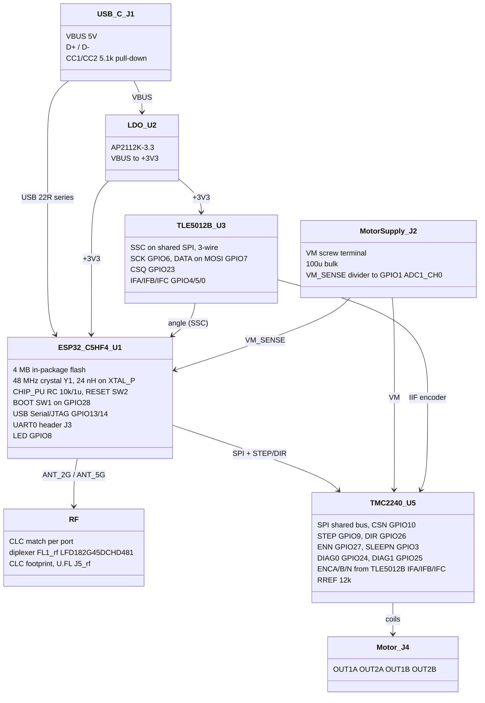

# Architecture

## Power-up and boot

CHIP_PU rises through 10k into 1u (tau 10 ms) and enables the ESP32-C5 at
about 0.75 VDD. Strapping pins are latched within 3 ms after that. The
TMC2240 stays asleep (SLEEPN internal pull-down) with outputs off (DRV_ENN
internal pull-up) until firmware drives both.

```mermaid
gantt
    title Power-up sequence (ms, approximate)
    dateFormat x
    axisFormat %L
    section Rails
    +3V3 ramps (LDO soft start)         :r, 0, 1
    section ESP32-C5
    CHIP_PU RC charging, chip held off  :c, 0, 14
    Straps latched (GPIO25..28, 7, 2, 3):s, 14, 17
    ROM boot and firmware init          :b, 17, 60
    section TMC2240
    SLEEPN low, DRV_ENN high (off)      :t, 0, 60
    Configured over SPI, then enabled   :e, 60, 70
```

